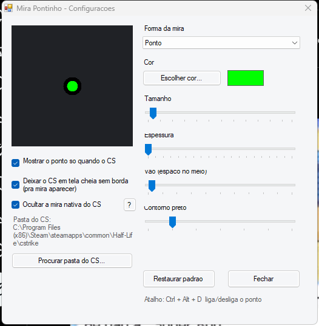
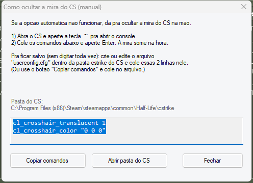

# Mira Pontinho — mira de ponto para CS 1.6

[🇧🇷 Português](#-português) · [🇬🇧 English](#-english)

[](https://github.com/taquinoc/cs16-dot-crosshair/releases/latest)
[](LICENSE)



Um overlay **externo** que desenha uma mira (ponto, cruz, T, círculo ou X) no centro da tela, por cima do **Counter-Strike 1.6**.

> **Sem risco de VAC:** o programa **não modifica** nenhum arquivo do jogo e **não injeta** nada no processo do CS. Ele apenas desenha uma janela por cima — igual às miras nativas de alguns monitores gamer. A única alteração (opcional) é um arquivo de configuração (`userconfig.cfg`), que também não é verificado pelo VAC.

---

## 🇧🇷 Português

### ✨ Recursos
- Formas: **Ponto, Cruz (+), T, Círculo e X**
- Cor, tamanho, espessura, vão e contorno ajustáveis
- **Pré-visualização ao vivo** enquanto você ajusta
- **Salvar e compartilhar miras**: biblioteca pessoal com nome + código pra importar/exportar (igual ao "share code" do CS:GO)
- **Idioma: Português ou English**
- Segue a janela do CS (funciona em janela e em **tela cheia sem borda**)
- **Oculta a mira nativa do CS** (só configuração — grava 2 linhas no `userconfig.cfg`, nada é injetado no jogo; + ajuda manual com botão **?**)
- **Esconde a mira no zoom** (AWP/Scout) automaticamente
- Atalho global **Ctrl + Alt + D** para ligar/desligar
- Ícone na bandeja do sistema
- Salva as configurações em `MiraPontinho.ini`
- **Portátil**: é só um `.exe`, não instala nada

### 🚀 Como usar
1. Baixe o `MiraPontinho.exe` na página de **[Releases](https://github.com/taquinoc/cs16-dot-crosshair/releases/latest)** (ou compile com `build.bat`).
2. Abra o `MiraPontinho.exe`.
3. Ajuste a mira na janela de configuração.
4. Abra o CS 1.6 — a mira aparece no centro quando o CS está em foco.

**Atalhos:** `Ctrl + Alt + D` liga/desliga · ícone perto do relógio → *Configurar / Sair*.

### 💾 Salvar e compartilhar miras
Na janela de configuração, clique em **"Miras / compartilhar por código..."** (ou no ícone da bandeja → *Miras / compartilhar...*):

- **Minhas miras:** salve a mira atual com um nome e aplique/exclua quando quiser (fica guardado no `MiraPontinho.ini`).
- **Compartilhar (código):** clique em **Exportar + copiar** pra gerar um código tipo `MIRA1-...` e mandar pra alguém. Pra usar a de outra pessoa, cole no campo e clique em **Importar código**.

### 🌎 Idioma
No rodapé da janela de configuração, escolha **Português** ou **English** — a janela já recarrega no idioma escolhido (e fica salvo).

### 🎯 Ocultar a mira nativa do CS
O CS 1.6 desenha a mira dele por cima de tudo, então fica feio com o ponto em cima. Marque a opção **"Deixar a mira do CS invisível (só config)"** — o programa **não injeta nada**: ele só grava 2 linhas de configuração no `userconfig.cfg` do CS:

```
cl_crosshair_color "0 0 0"
cl_crosshair_translucent "1"
```

Como a mira do CS fica em modo aditivo, o preto deixa ela invisível. **Reinicie o CS** para aplicar.

Não funcionou? Clique no botão **?** ao lado da opção — abre um passo a passo para ocultar na mão, com botão de **copiar os comandos** e **abrir a pasta do CS**:



### 🔭 Zoom (AWP/Scout)
Quando você dá zoom com a AWP/Scout, o CS cobre a tela com o scope. A opção **"Esconder a mira no zoom"** detecta isso (pela tela ficar quase toda preta) e esconde o ponto, pra não atrapalhar. Se ele esconder demais ou de menos, ajuste a **"Sensibilidade do zoom"**.

> É uma detecção **visual** (sem injetar nada no jogo), então em cenas muito escuras pode variar. Dá pra desligar a opção e usar o atalho manual.

### 🖥️ Tela cheia
O Windows não deixa janelas comuns aparecerem por cima de jogos em "tela cheia exclusiva". Por isso o programa deixa o CS em **tela cheia sem borda** (opção ligada por padrão) — fica idêntico à tela cheia, e a mira aparece por cima. Se ainda assim não aparecer, deixe o CS em modo janela uma vez (*Options → Video → "Run in a window"*).

### ⌨️ Linha de comando
```
MiraPontinho.exe --silent              só a mira (sem abrir a configuração)
MiraPontinho.exe --r 255 --g 0 --b 0   cor inicial
MiraPontinho.exe --size 8              tamanho inicial
MiraPontinho.exe --hide-cs             oculta a mira nativa do CS
MiraPontinho.exe --show-cs             restaura a mira nativa do CS
MiraPontinho.exe --help-manual         abre a ajuda manual
MiraPontinho.exe --no-borderless       não mexe na janela do CS
MiraPontinho.exe --hide-scope          esconde a mira no zoom (padrão)
MiraPontinho.exe --no-hide-scope       não esconde a mira no zoom
MiraPontinho.exe --scope-threshold 55  sensibilidade do zoom (25 a 85)
```

### 🔧 Compilar
Precisa apenas do .NET Framework (já vem no Windows). Rode:

```
build.bat
```

### ⚠️ Aviso
É uma mira cosmética **externa**. O VAC não detecta (não injeta nada no jogo), mas alguns administradores de servidor podem não gostar por ser um recurso externo. Use por sua conta.

---

## 🇬🇧 English

### What is it?
An **external overlay** that draws a crosshair (dot, cross, T, circle or X) in the center of the screen, on top of **Counter-Strike 1.6**.

> **No VAC risk:** it does **not** modify any game file and does **not** inject anything into the CS process. It just draws a window on top (like the built-in crosshair of some gaming monitors). The only (optional) change is a config file (`userconfig.cfg`), which VAC does not check either.

### Features
- Shapes: **Dot, Cross (+), T, Circle and X**
- Adjustable color, size, thickness, gap and outline
- **Live preview**
- **Save & share crosshairs**: personal named library + import/export code (like CS:GO "share codes")
- **Language: Portuguese or English**
- Follows the CS window (works windowed and in **borderless fullscreen**)
- **Hides the native CS crosshair** (config only — writes 2 lines to `userconfig.cfg`, nothing is injected into the game; plus manual help with a **?** button)
- **Auto-hides the crosshair when scoped** (AWP/Scout)
- Global hotkey **Ctrl + Alt + D** to toggle
- System tray icon
- Saves settings to `MiraPontinho.ini`
- **Portable**: a single `.exe`, no install

### Usage
1. Download `MiraPontinho.exe` from the **[Releases](https://github.com/taquinoc/cs16-dot-crosshair/releases/latest)** page (or build with `build.bat`).
2. Run `MiraPontinho.exe`.
3. Adjust the crosshair in the settings window.
4. Launch CS 1.6 — the crosshair appears in the center while CS is focused.

### Save & share crosshairs
In the settings window click **"Miras / compartilhar por código..."** (or the tray icon → *Miras / compartilhar...*):

- **Minhas miras (my crosshairs):** save the current crosshair with a name and apply/delete it anytime (stored in `MiraPontinho.ini`).
- **Share (code):** click **Exportar + copiar** to generate a code like `MIRA1-...` and send it to someone. To use one, paste it in the box and click **Importar código**.

### Language
At the bottom of the settings window, pick **Português** or **English** — the window reloads in the chosen language (and it is saved).

### Zoom (AWP/Scout)
When you scope with the AWP/Scout, CS covers the screen with the scope. The **"Hide crosshair when scoped"** option detects it (the screen becomes mostly black) and hides the dot. Adjust **"Scope sensitivity"** if it triggers too much or too little.

> It is a **visual** detection (nothing is injected into the game), so very dark scenes may vary. You can turn it off and use the manual hotkey instead.

### Command line
```
MiraPontinho.exe --silent              overlay only (no settings window)
MiraPontinho.exe --r 255 --g 0 --b 0   initial color
MiraPontinho.exe --size 8              initial size
MiraPontinho.exe --hide-cs             hide the native CS crosshair
MiraPontinho.exe --show-cs             restore the native CS crosshair
MiraPontinho.exe --help-manual         open the manual help
MiraPontinho.exe --no-borderless       do not touch the CS window
MiraPontinho.exe --hide-scope          hide the crosshair when scoped (default)
MiraPontinho.exe --no-hide-scope       do not hide when scoped
MiraPontinho.exe --scope-threshold 55  scope detection sensitivity (25-85)
```

### Build
Requires only the .NET Framework (bundled with Windows):

```
build.bat
```

### Disclaimer
It is an **external cosmetic** crosshair. VAC does not detect it (nothing is injected into the game), but some server admins may dislike it for being an external tool. Use at your own risk.

---

## 📄 Licença / License
MIT — see [LICENSE](LICENSE).
